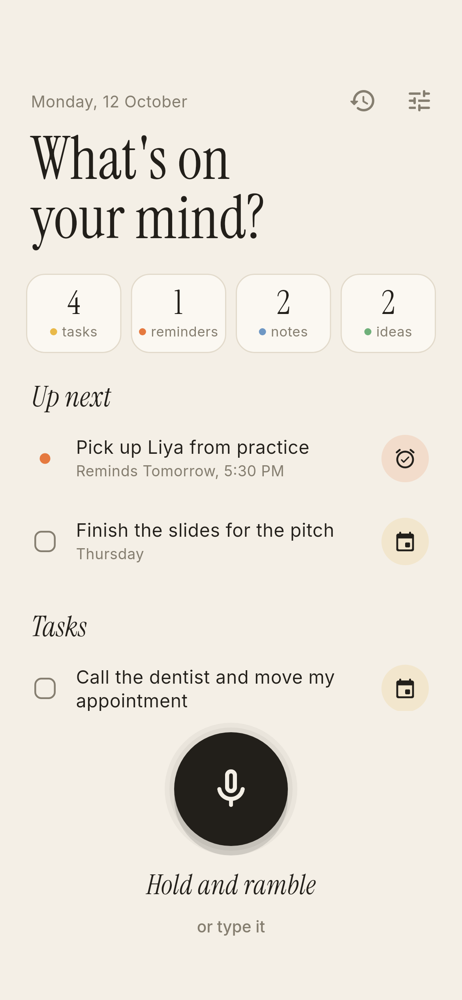
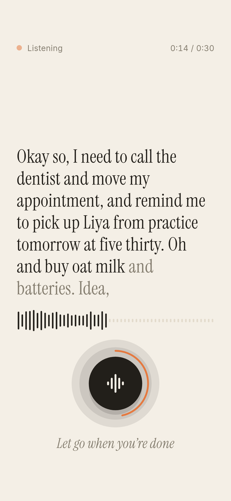
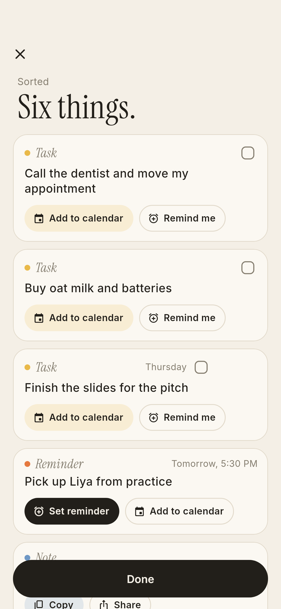
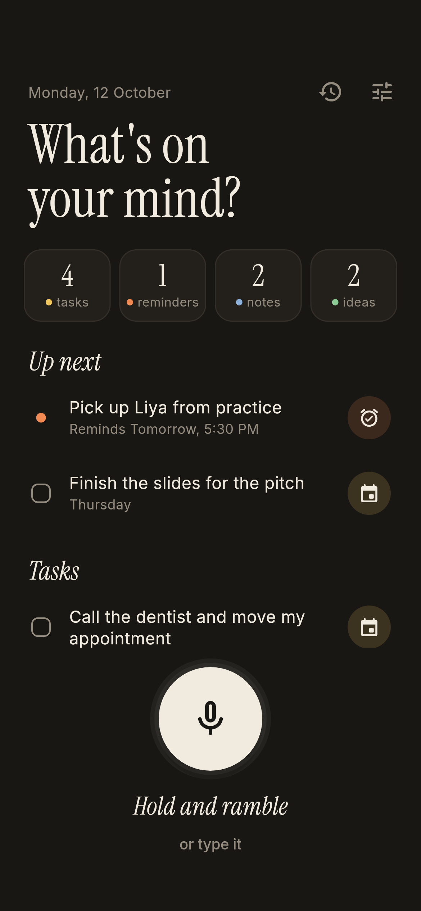
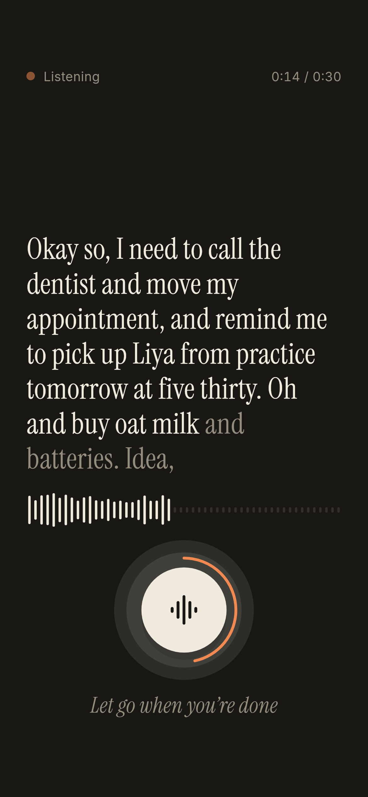
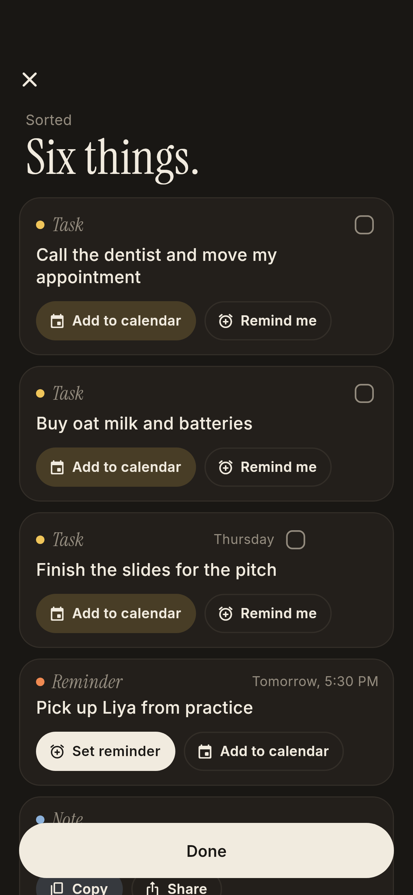
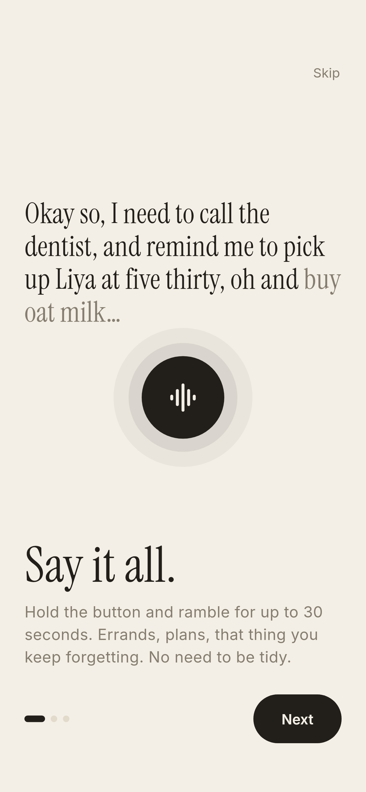
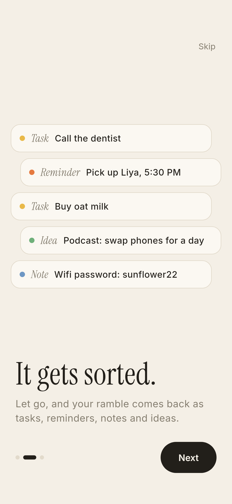
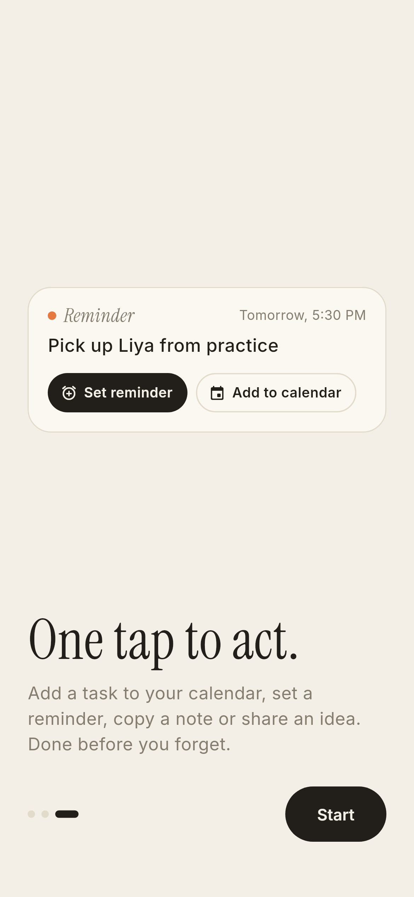
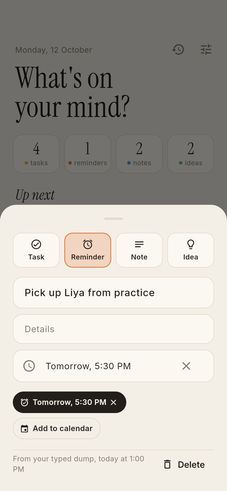

# Brain Dump

**Hold a button and ramble for 30 seconds.** Brain Dump sorts what you said
into tasks, reminders, notes and ideas, each with a one-tap action like
"Add to calendar" or "Set reminder". It's faster than typing, and the result is
useful straight away.

A Flutter app for Android and iOS.

<p>
  
  
  
</p>
<p>
  
  
  
</p>

## What it does

- **Hold to ramble.** Press and hold the big button and say everything at once.
  Your words appear in large type as you talk, the rings around the button grow
  with your voice, and an orange arc fills over the 30 seconds. Let go to sort.
  A quick tap reminds you to keep holding.
- **Sorted for you.** The ramble comes back as separate items, worded cleanly:
  "Okay so I need to call the dentist and, oh, remind me to pick up Liya
  tomorrow at five thirty" becomes a task and a reminder for tomorrow at
  5:30 PM. Dates like "Thursday", "tonight", "at 7pm" and "in 20 minutes" are
  worked out for you.
- **One tap to act.**
  - Tasks: **Add to calendar** (opens your calendar app with the event filled
    in), **Remind me**, and a checkbox to tick them off.
  - Reminders: **Set reminder** schedules a notification at the time you said,
    or asks for one. Tap it again to change the time, × to cancel.
  - Notes: **Copy** and **Share**.
  - Ideas: **Share** and **Copy**.
- **Fix anything.** Tap an item to reword it, add details, set or clear a time,
  move it to a different kind, or delete it (with undo).
- **Home is your inbox.** Open items grouped by kind, with what's coming up
  first. Tap a count to filter. Swipe left to delete.
- **Type it** when you can't talk out loud ("or type it" under the button).
- **Past dumps**, with what you said, what it became, and which engines did
  the work.
- Light and dark mode, an onboarding walkthrough, and everything stored on the
  phone.

<p>
  
  
  
  
</p>

## Speech and sorting

Brain Dump works out of the box with no keys and no internet. Add keys in
**Settings** to make it smarter.

| | Hearing you | Sorting |
| --- | --- | --- |
| **No keys** (default) | The phone's own speech recognition, with words appearing live | Built-in rules, offline |
| **OpenAI key** | Whisper (`whisper-1`), more accurate with accents and noise; words appear when you let go | `gpt-4.1-mini` with a strict JSON schema |
| **Claude key** | n/a | `claude-haiku-5-5` with a forced tool call |

- Both AI sorters get the same instructions and JSON shape
  (`lib/data/ai.dart`): a title, plus items with `kind`, `text`, `details`, `due`
  (local `YYYY-MM-DDTHH:MM`) and `all_day`. The prompt includes the current
  local time and weekday, so "tomorrow at 5" resolves correctly.
- Model names can be changed under **Settings → Models**.
- If an AI service fails (offline, bad key, rate limit), the dump is sorted
  with the built-in rules instead, and the results screen says why.
- Keys are kept in the platform's secure storage (Android Keystore / iOS
  Keychain). Recordings and transcripts only go to the service you picked.
  Audio files are deleted once transcribed.

The built-in rules (`lib/data/local_sorter.dart`) split the ramble at
sentence breaks and joins like "and also" or "oh and" that come before a new
intent, then look for cue words: "remind me" makes a reminder; "idea" or
"what if" makes an idea; "need to", "have to" or a leading verb like "buy" or
"call" makes a task; passwords, numbers and addresses make notes. Dates are
read by `lib/data/when.dart`.

## Run it

```sh
flutter pub get
flutter run
```

Build an APK to install on an Android phone:

```sh
flutter build apk --release
# -> build/app/outputs/flutter-apk/app-release.apk
```

The release build is signed with the debug key, which is fine for installing
it yourself. Publishing to the Play Store needs your own signing key.

Pushing a tag such as `v1.0.0` (or starting the **Release** workflow by hand)
builds the APKs and publishes a GitHub release with notes from
`docs/releases/<tag>.md`.

### Permissions

- **Microphone** and **speech recognition**, to hear you.
- **Notifications**, asked the first time you set a reminder. On Android 12 and
  later, reminders arrive on the minute only if "Alarms & reminders" is
  allowed; otherwise Android may deliver them a few minutes late, and the app
  offers a shortcut to the setting.
- **Internet**, only used when you've added an AI key.

## Design

The look is **Paper**: warm off-white paper, ink, Instrument Serif headlines
and Inter for everything else. Kind colours appear as small dots, rules and
tints. It was picked from six directions over two rounds of renders; the boards
and the reasoning are in [docs/design](docs/design/README.md).


## Code layout

| Path | What |
| --- | --- |
| `lib/main.dart`, `lib/app.dart` | Start-up, theme mode, onboarding vs. home |
| `lib/theme.dart` | The Paper tokens (light and dark) and Material theme |
| `lib/data/models.dart` | `Kind`, `Item`, `Dump` |
| `lib/data/store.dart` | Dumps saved in shared preferences, with undo |
| `lib/data/settings.dart` | Settings; API keys in secure storage |
| `lib/data/ai.dart` | Whisper, OpenAI and Claude clients, prompt and schema |
| `lib/data/local_sorter.dart` | Offline sorting rules |
| `lib/data/when.dart` | Reading spoken dates, formatting times |
| `lib/capture/voice.dart` | Phone speech recognition and the Whisper recorder |
| `lib/capture/capture.dart` | Hold → listen → transcribe → sort → save |
| `lib/capture/brain.dart` | Picks the engines from Settings, with fallback |
| `lib/actions/reminders.dart` | Local notifications |
| `lib/ui/` | Home, hold button, results, item sheet, history, settings, onboarding |

## Tests

```sh
flutter analyze
flutter test
```

The tests cover date reading, the built-in sorter, both AI clients (request
shape, schema, error messages) against a mock HTTP client, the store, the whole
capture flow with a fake microphone (including the 30-second cut-off and AI
fallback), and widget tests that hold the real button, release it, and act on
the results. Widget tests load the bundled fonts, so text is laid out the way
it is on a phone.

## Screenshots and icon

```sh
flutter test tool/render --update-goldens && cp tool/render/out/*.png docs/screenshots/
flutter test tool/icon --update-goldens && cp tool/icon/icon_*.png assets/icon/
dart run flutter_launcher_icons

# Design exploration boards
tool/design/get_fonts.sh
flutter test tool/design/explore_test.dart tool/design/round2_test.dart --update-goldens
```

Fonts: Instrument Serif and Inter, bundled in `assets/fonts` under the SIL Open
Font License.
