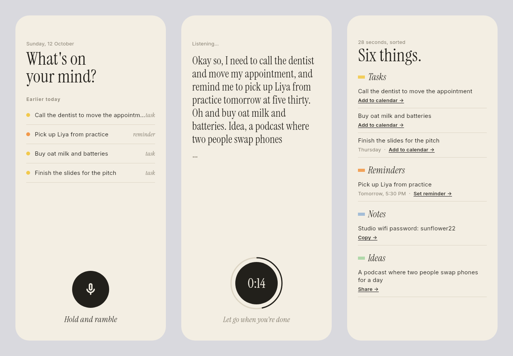
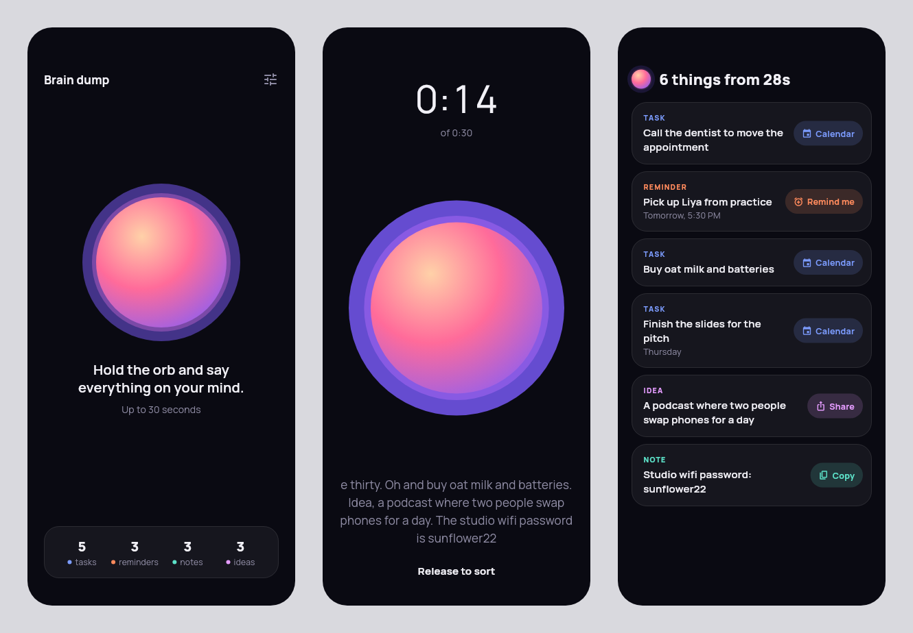
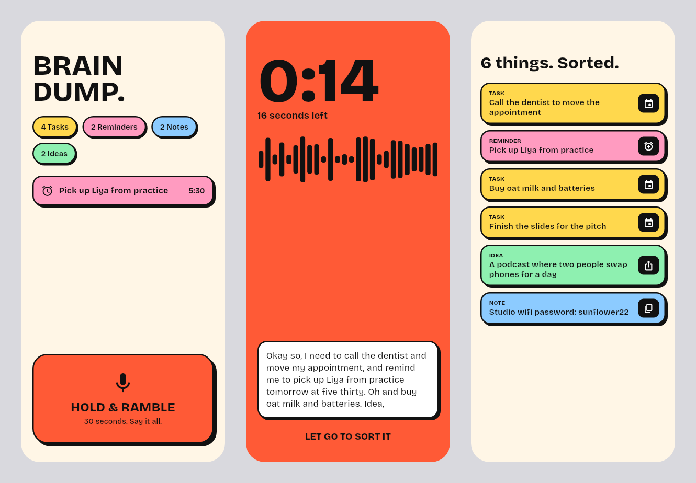
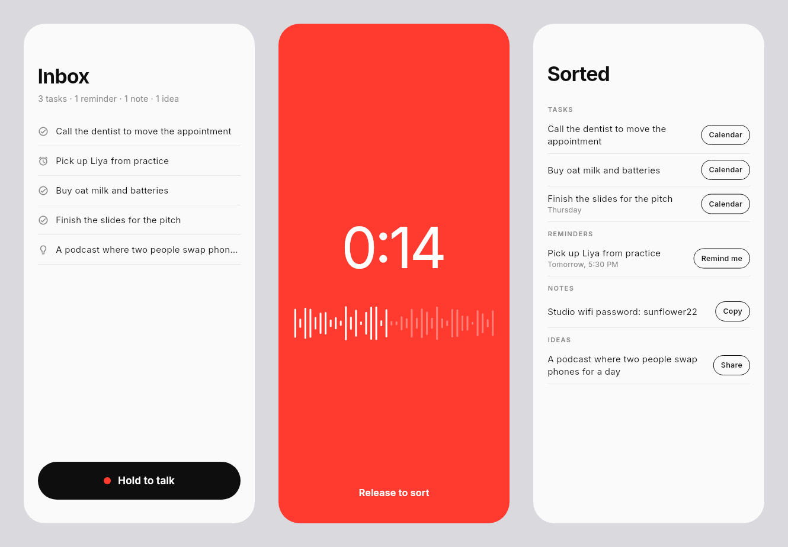
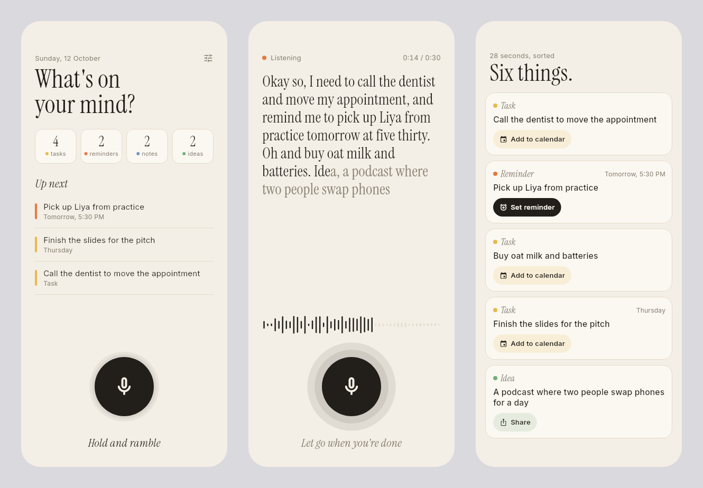
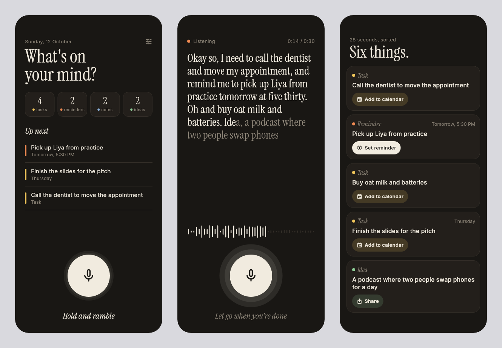
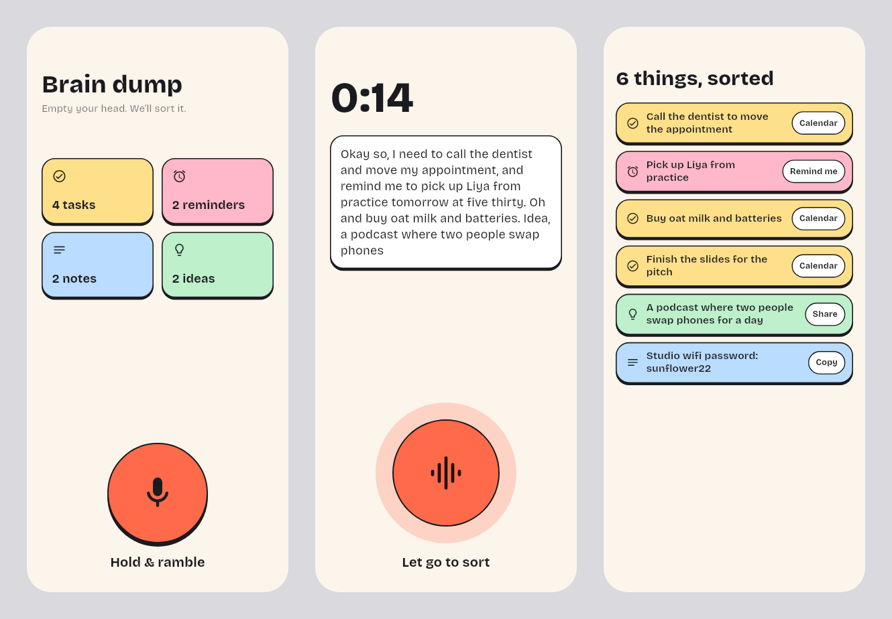

# Design exploration

Each direction is drawn as the same three screens with the same 28-second
ramble: **idle** (what you see when you open the app), **recording** (while
you hold the button) and **sorted** (what comes back). The boards are rendered
by `tool/design/explore_test.dart` (round 1) and `tool/design/round2_test.dart`
(round 2).

## Round 1: four directions

### A. Notebook

Warm paper, ink and Instrument Serif headlines. The recording screen shows
your own words in big serif type, which is the moment you can see the app
working. The weak spot is the actions: they are thin underlined links, not
one-tap buttons.

### B. Night orb

Dark, with a glowing orb that is the button. The tinted action pills on the
results are the clearest one-tap actions of the round. But a glowing AI orb on
black is what every AI app looks like, and there is no light mode.

### C. Sticky blocks

Neo-brutalist: thick outlines, hard shadows, one loud colour per kind. You can
read the sort at a glance. It is too loud for something you open several times
a day, and the colour competes with the words.

### D. Signal

Minimal monochrome with a red recording screen. Clean but forgettable, and the
full red screen feels like an alarm, not a place to think out loud.

## Round 2: the two strongest, refined

### E. Paper (A + B's action pills)

A's paper and serif, plus:
- real action pills tinted with the kind's colour; the most time-sensitive one
  is filled in ink
- a bigger button with rings that grow with your voice
- a live waveform
- the words you just said fade in from grey to ink
- counts per kind and an "Up next" list on the home screen
- a dark mode with the same warmth

### F. Soft blocks (C, toned down)

Thinner outlines, pastel colours and a 2×2 grid of kinds. Friendlier than C,
but the grid of coloured tiles still pulls focus from the actual content, and
it looks like many other to-do apps.

## Choice: E, Paper

- **Calm.** You open this app when your head is full. Paper and serif type slow
  the pace down; neon and hard shadows speed it up.
- **The recording screen shows your words.** Seeing what you said as you say it
  builds trust that the sort will be right. A and E were the only directions
  where the transcript was the hero.
- **Actions are buttons.** E fixes A's weak spot with B's pills, so "Add to
  calendar" and "Set reminder" really are one tap.
- **It has a dark mode** that keeps the same feel.
- **Colour stays a hint.** Kind colours appear as small dots, rules and tints,
  so they help you scan without shouting.

### Tokens

| | Light | Dark |
| --- | --- | --- |
| Paper | `#F4EFE6` | `#191714` |
| Card | `#FBF8F2` | `#231F1B` |
| Ink | `#221F1A` | `#F1EBDF` |
| Faint | `#8C8577` | `#8F877A` |
| Rule | `#E2DACB` | `#332E28` |
| Task | `#E9B949` | `#F0C55A` |
| Reminder | `#E5793F` | `#F08A52` |
| Note | `#6E97C4` | `#8DB2DB` |
| Idea | `#6FB07A` | `#8CCB95` |

Type: **Instrument Serif** for headlines, kind labels and the live transcript;
**Inter** for everything else. Both are bundled under the SIL Open Font License.
